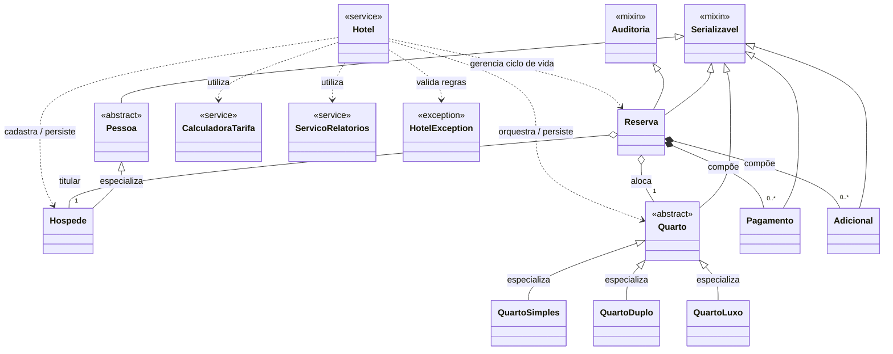

# 🏨 Sistema de Reservas de Hotel 

> **Instituição:** Universidade Federal do Cariri (UFCA) — Centro de Ciências e Tecnologia (CCT)  
> **Curso:** Bacharelado em Engenharia de Software  
> **Disciplina:** Programação Orientada a Objetos (Projeto 1 - Tema 8)  

---

## 📌 Sumário

1. [Descrição do Projeto](#1-descrição-do-projeto)
2. [Objetivos e Finalidade](#2-objetivos-e-finalidade)
3. [Modelagem UML (Visão Geral)](#3-modelagem-uml-visão-geral)
4. [Arquitetura e Estrutura de Diretórios](#4-arquitetura-e-estrutura-de-diretórios)
5. [Instalação, Execução e Testes](#5-instalação-execução-e-testes)
6. [Cronograma de Entregas](#6-cronograma-de-entregas)

---

## 1. Descrição do Projeto

O **Sistema de Reservas de Hotel** informatiza a operação e a gestão financeira de um estabelecimento hoteleiro utilizando modelagem orientada a objetos em Python. O software gerencia o cadastro de acomodações (**Simples**, **Duplo** e **Luxo**) e de hóspedes, controlando todo o ciclo de vida das reservas, *check-in*, *check-out*, lançamentos de consumos adicionais, pagamentos e bloqueios de quartos para manutenção.

O domínio da aplicação impede *overbooking* e extrapolação da capacidade física dos quartos, calcula diárias dinâmicas baseadas em temporadas e fins de semana (parametrizadas via `settings.json`) e processa cancelamentos com cálculo de multas e registros de *no-show*. A persistência de dados é realizada de forma desacoplada em banco relacional **SQLite**, e os serviços são disponibilizados através de uma API REST construída com **FastAPI**, preparada para integração direta com aplicativos móveis desenvolvidos no **MIT App Inventor**.

---

## 2. Objetivos e Finalidade

### 🎯 Objetivo Geral
Automatizar o fluxo operacional e financeiro hoteleiro, garantindo a integridade dos dados, o controle rigoroso das transições de estado das reservas (`PENDENTE`, `CONFIRMADA`, `CHECKIN`, `CHECKOUT`, `CANCELADA` e `NO_SHOW`) e a apuração de indicadores gerenciais de desempenho:
* **Taxa de Ocupação (%)**
* **ADR (*Average Daily Rate*)** — Diária Média
* **RevPAR (*Revenue per Available Room*)** — Receita por Quarto Disponível

### ⚙️ Objetivos Técnicos de POO
* **Herança Simples e Polimorfismo:** Especialização nas hierarquias `Pessoa` $\rightarrow$ `Hospede` e `Quarto` $\rightarrow$ `QuartoSimples`, `QuartoDuplo` e `QuartoLuxo`, com cálculo polimórfico de tarifas diárias.
* **Herança Múltipla via Mixins:** Reuso transversal de comportamentos com `Auditoria(Mixin)` (rastreio temporal de criação e atualização) e `Serializavel(Mixin)` (conversão padronizada para dicionários e JSON).
* **Composição e Agregação:** Relacionamento estrutural em `Reserva`, agregando `Hospede` e `Quarto` e compondo listas de objetos `Pagamento` e `Adicional`.
* **Encapsulamento e Tratamento de Erros:** Proteção de atributos e validação de invariantes com `@property`, aliada a uma hierarquia de exceções customizadas de domínio (`HotelException` e subclasses).
* **Métodos Especiais (*Dunder Methods*):** Implementação de `__str__` e `__repr__` (representação textual), `__lt__` (ordenação natural de quartos por categoria e número), `__len__` (quantidade de diárias da reserva) e `__eq__` (detecção de conflito de quarto e período).
* **Persistência e Qualidade:** Armazenamento relacional estruturado com `sqlite3` e suíte de testes automatizados com `pytest`.

---

## 3. Modelagem UML (Visão Geral)

Abaixo encontra-se uma representação simplificada da arquitetura de classes do domínio e da camada de serviços, destacando as relações de herança, composição, agregação e dependência:



> 📄 **Documentação Completa dos Diagramas:**  
> Para visualizar os **diagramas individuais detalhados de cada classe** (com todos os atributos, `@property`, tipagens e métodos especiais), além das **Máquinas de Estado** e **Diagramas de Sequência**, acesse a especificação completa no repositório:  
> 👉 **[Especificação UML Completa (`docs/uml_diagram.md`)](./docs/uml_diagram.md)**  
> 👉 **[Regras de Negócio e Políticas (`docs/busines_rules.md`)](./docs/busines_rules.md)**  
---

## 4. Arquitetura e Estrutura de Diretórios

O projeto adota uma arquitetura modular em camadas, isolando as entidades de negócio (`src/models/`) das regras de orquestração (`src/services/`), da persistência em banco de dados (`src/database/`) e da interface HTTP (`src/api/`):

```text
sistema-reservas-hotel/          <-- Raiz do repositório
│
├── .github/                     <-- 📁 INTEGRAÇÃO CONTÍNUA (CI/CD)
│   └── workflows/
│       └── ci.yml               <-- Pipeline de testes automatizados no GitHub Actions
│
├── main.py                      <-- Ponto de entrada para execução do servidor FastAPI (Uvicorn)
├── settings.json                <-- Parâmetros configuráveis (horários, temporadas, multas, tolerâncias)
├── requirements.txt             <-- Dependências externas (fastapi, uvicorn, pytest, httpx)
├── pytest.ini                   <-- Arquivo de configuração da suíte de testes pytest
├── README.md                    <-- Documentação principal e visão geral do projeto
├── .gitignore                   <-- Arquivos ignorados pelo versionamento Git
│
├── docs/                        <-- 📁 PASTA DE DOCUMENTAÇÃO
│   ├── uml_diagram.md           <-- Especificação detalhada dos Diagramas de Classes e Sequência (Mermaid)
│   ├── busines_rules.md         <-- Detalhamento das políticas de tarifas, regras de transição e multas
│   ├── tests.md                 <-- Documentação e plano de cobertura dos testes do sistema
│   └── decisions.md             <-- Registro de decisões de arquitetura e projeto
│
├── src/                         <-- 📁 PACOTE PRINCIPAL DO CÓDIGO-FONTE
│   ├── __init__.py
│   │
│   ├── models/                  <-- 📁 CAMADA DE DOMÍNIO (Classes POO, Herança e Mixins)
│   │   ├── __init__.py
│   │   ├── enums.py             <-- Enumerações de estado e tipos (StatusReserva, TipoQuarto, etc.)
│   │   ├── exceptions.py        <-- Hierarquia de Exceções Customizadas de domínio (HotelException)
│   │   ├── mixins.py            <-- Mixins de herança múltipla (Auditoria, Serializavel)
│   │   ├── person.py            <-- Classes Pessoa (base abstrata) e Hospede
│   │   ├── room.py              <-- Classes Quarto (base), QuartoSimples, QuartoDuplo, QuartoLuxo
│   │   ├── payment.py           <-- Classes financeiras e de consumo (Pagamento e Adicional)
│   │   └── reservation.py       <-- Classe central Reserva (ciclo de vida, datas e composições)
│   │
│   ├── services/                <-- 📁 CAMADA DE REGRAS DE NEGÓCIO E SERVIÇOS
│   │   ├── __init__.py
│   │   ├── hotel.py             <-- Orquestrador central (overbooking, check-in/out, cancelamento, no-show)
│   │   ├── rates.py             <-- Funções puras de cálculo de diárias (temporadas e fins de semana)
│   │   └── reports.py           <-- Motor de apuração de indicadores gerenciais (Ocupação, ADR, RevPAR)
│   │
│   ├── database/                <-- 📁 CAMADA DE PERSISTÊNCIA E DADOS (SQLite)
│   │   ├── __init__.py
│   │   ├── connection.py        <-- Gestão de conexão com sqlite3 e inicialização das tabelas
│   │   ├── data.py              <-- Operações de persistência (salvar/carregar entidades do domínio)
│   │   ├── seed.py              <-- Carga de dados iniciais (8 quartos padrão e temporadas do settings)
│   │   └── hotel.db             <-- Banco de dados relacional SQLite
│   │
│   └── api/                     <-- 📁 CAMADA DE INTERFACE E COMUNICAÇÃO (FastAPI)
│       ├── __init__.py
│       ├── app.py               <-- Instância principal do servidor FastAPI e ciclo de vida (lifespan)
│       └── routes.py            <-- Definição dos 24 endpoints HTTP e Schemas de validação Pydantic
│
└── tests/                       <-- 📁 CAMADA DE TESTES AUTOMATIZADOS (pytest)
    ├── __init__.py
    ├── test_api.py              <-- Testes HTTP de integração dos 24 endpoints da API (66 testes)
    ├── test_models.py           <-- Testes de criação de objetos, @property e métodos especiais (26 testes)
    ├── test_database.py         <-- Testes de persistência relacional e integridade SQLite (4 testes)
    ├── test_rules.py            <-- Testes de regras de negócio, disponibilidade e cancelamento (35 testes)
    ├── test_rates.py            <-- Testes de precificação dinâmica, temporadas e fins de semana (43 testes)
    └── test_reports.py          <-- Testes de precisão dos cálculos de Ocupação, ADR e RevPAR (62 testes)
```

---

## 5. Instalação, Execução e Testes
### 5.1. Instalação e Ambiente
1. Clone o repositório e acesse a pasta raiz:
   ```bash
   git clone <url-do-repositorio>
   cd Sistema-de-Reserva-de-Hotel
   ```
2. Crie e ative um ambiente virtual (recomendado):
   ```bash
   python -m venv .venv
   # Windows (PowerShell):
   .venv\Scripts\Activate.ps1
   # Linux / macOS:
   source .venv/bin/activate
   ```
3. Instale as dependências:
   ```bash
   pip install -r requirements.txt
   ```

### 5.2. Execução da API
Inicie o servidor HTTP com Uvicorn:
```bash
python main.py
```
* **Servidor local:** `http://127.0.0.1:8000`
* **Documentação Interativa (Swagger UI):** `http://127.0.0.1:8000/docs`
* *O banco SQLite (`hotel.db`) e o seed de 8 quartos e temporadas são carregados automaticamente na inicialização.*

### 5.3. Testes Automatizados (pytest)
O projeto conta com **236 testes automatizados** cobrindo invariantes de domínio, persistência relacional e contratos HTTP:

* **Executar toda a suíte:**
  ```bash
  pytest
  ```
* **Executar suítes específicas:**
  ```bash
  pytest tests/test_api.py       # 66 testes: CRUDs, ciclo completo de atendimento, regras e erros HTTP
  pytest tests/test_models.py    # 26 testes: invariantes com @property, dunder methods e mixins
  pytest tests/test_database.py  # 4 testes: tabelas, conexões e integridade SQLite
  pytest tests/test_rules.py     # 35 testes: regras de negócio, disponibilidade e cancelamento
  pytest tests/test_rates.py     # 43 testes: precificação dinâmica, temporadas e fins de semana
  pytest tests/test_reports.py   # 62 testes: precisão de Ocupação, ADR e RevPAR
  ```

### 5.4. Exemplos Principais de Uso da API

Os endpoints podem ser consumidos via HTTP ou diretamente pela interface Swagger (`/docs`):

#### Cadastros de quartos e hóspedes (CRUD)

| Operação | Quartos | Hóspedes |
| :--- | :--- | :--- |
| Cadastrar | `POST /quartos` | `POST /hospedes` |
| Listar todos | `GET /quartos` | `GET /hospedes` |
| Consultar um | `GET /quartos/{numero}` | `GET /hospedes/{id}` |
| Atualizar | `PUT /quartos/{numero}` | `PUT /hospedes/{id}` |
| Excluir | `DELETE /quartos/{numero}` | `DELETE /hospedes/{id}` |

O `PUT` recebe todos os campos cadastrais obrigatórios. Campos opcionais omitidos
voltam aos valores padrão. O número do quarto e o ID do hóspede são fixos, definidos
na URL. A edição do quarto preserva seu estado e o período de manutenção; bloqueios,
check-in e check-out continuam sendo feitos pelas operações específicas.

Exemplo de `PUT /quartos/101`:

```json
{
  "tipo": "SIMPLES",
  "capacidade": 2,
  "tarifa_base": 180.0
}
```

Para `PUT /hospedes/1`, use os mesmos campos do cadastro de hóspede abaixo.
Atualizações preservam as reservas vinculadas e os valores de diárias já contratados.
Não é permitido reduzir a capacidade abaixo do número de hóspedes de qualquer
reserva vinculada, inclusive histórica (`400`).

Uma exclusão bem-sucedida retorna `204`, sem corpo. Cadastros com reservas vinculadas
não podem ser excluídos (`409`), mesmo após cancelamento ou encerramento da estadia.
Documento duplicado também retorna `409`; identificadores inexistentes retornam `404`.

#### 1. Cadastrar Hóspede
* **`POST /hospedes`**
  ```json
  {
    "nome": "Carlos Silva",
    "documento": "123.456.789-00",
    "email": "carlos@email.com",
    "telefone": "88999998888",
    "preferencias": "Andar alto"
  }
  ```
  *Retorno (201 Created): Retorna os dados do hóspede com o `id` gerado pelo banco.*

#### 2. Criar Reserva (com cálculo tarifário dinâmico)
* **`POST /reservas`**
  ```json
  {
    "hospede_id": 1,
    "quarto_num": 101,
    "entrada": "2026-11-10",
    "saida": "2026-11-13",
    "num_hospedes": 1,
    "origem": "BALCAO"
  }
  ```
  *Retorno (201 Created): Reserva em status `CONFIRMADA`, aplicando multiplicadores de alta temporada e fins de semana sobre a tarifa base.*

#### 3. Realizar Check-in
* **`POST /reservas/1/checkin`**
  ```json
  {
    "momento": "2026-11-10T14:15:00"
  }
  ```
  *Regra: Valida janela de horário (a partir das 14:00 com tolerância). Atualiza a reserva para `CHECKIN` e o quarto para `OCUPADO`.*

#### 4. Lançar Consumo Adicional
* **`POST /reservas/1/adicionais`**
  ```json
  {
    "descricao": "Café da manhã especial",
    "preco": 35.0,
    "quantidade": 2
  }
  ```
  *Regra: Permitido estritamente para reservas ativas em `CHECKIN`.*

#### 5. Registrar Pagamento
* **`POST /reservas/1/pagamentos`**
  ```json
  {
    "valor": 520.0,
    "metodo": "PIX"
  }
  ```
  *Regra: Abate o saldo devedor da reserva e armazena comprovante.*

#### 6. Realizar Check-out
* **`POST /reservas/1/checkout`**
  ```json
  {
    "momento": "2026-11-13T11:30:00"
  }
  ```
  *Regra: Exige check-in real registrado e saída em horário igual ou posterior a ele; datas anteriores retornam `400` sem encerrar a estadia. Valida quitação financeira (total pago $\ge$ total devido). Em caso de atraso após 12:30, cobra diária extra. Altera status para `CHECKOUT` e libera o quarto para `DISPONIVEL`.*

#### 7. Consultar Relatórios
* **Taxa de Ocupação (%):** `GET /relatorios/ocupacao?inicio=2026-11-01&fim=2026-11-30`
* **ADR (Average Daily Rate):** `GET /relatorios/adr?inicio=2026-11-01&fim=2026-11-30`
* **RevPAR (Revenue per Available Room):** `GET /relatorios/revpar?inicio=2026-11-01&fim=2026-11-30`
* **Receita Financeira:** `GET /relatorios/financeiro?inicio=2026-11-01&fim=2026-11-30`

---

## 6. Cronograma de Entregas

| Etapa | Data Limite | Tag Git | Escopo Principal |
| :--- | :---: | :---: | :--- |
| **Semana 1** | 29/09/2026 | `entrega1` | Modelagem UML, `README.md` inicial e esqueleto das classes com *docstrings*. |
| **Semana 2** | 06/10/2026 | `entrega2` | Implementação de `Quarto`, `Hospede` e `Reserva` com `@property`, métodos especiais e testes básicos. |
| **Semana 3** | 13/10/2026 | `entrega3` | Herança, associações com `Pagamento` e `Adicional`, persistência SQLite e relatório inicial de ocupação. |
| **Semana 4** | 27/10/2026 | `entrega4` | Fluxos de *check-in/out*, cancelamento com multa, *no-show*, tarifas por temporada, manutenção e API FastAPI. |
| **Semana 5** | 03/11/2026 | `v1.0` | Relatórios consolidados (ADR, RevPAR, Ocupação e Cancelamentos), documentação final e cobertura de testes. |
