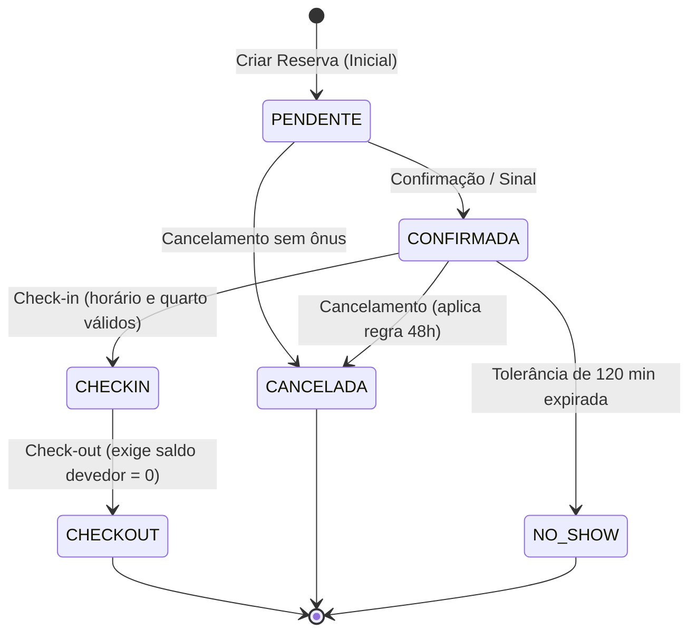

# 📋 Regras de Negócio e Políticas do Sistema

**Projeto:** Sistema de Reservas de Hotel (Tema 8)  
**Disciplina:** Programação Orientada a Objetos — UFCA  
**Configuração Central:** `settings.json`  

---

## 1. Visão Geral
Este documento define as regras operacionais, restrições e políticas de negócio aplicadas pelo sistema. As regras são orquestradas pela camada de serviços (`Hotel`, `CalculadoraTarifa`) e garantidas pelas entidades de domínio (`Reserva`, `Quarto`), utilizando exceções personalizadas herdadas de `HotelException`.

---

## 2. Regras de Negócio 

### 2.1. Disponibilidade e Prevenção de Overbooking
* **Regra:** Não é permitido haver duas reservas ativas (`CONFIRMADA` ou `CHECKIN`) sobrepostas para o mesmo quarto.
* **Critério de Conflito:** $\text{data\_entrada}_{\text{nova}} < \text{data\_saida}_{\text{existente}} \quad \text{e} \quad \text{data\_saida}_{\text{nova}} > \text{data\_entrada}_{\text{existente}}$
* **Violação:** Dispara `QuartoIndisponivelException`.

```text
Reserva Ativa:    [----- 10/05 a 15/05 -----]
Nova Tentativa 1:        [----- 12/05 a 17/05 -----] ❌ BLOQUEADO (Conflito de datas)
Nova Tentativa 2:                                  [----- 15/05 a 18/05 -----] ✅ LIBERADO
```

---

### 2.2. Capacidade Física do Quarto
* **Regra:** O número de hóspedes deve ser no mínimo 1 e não pode ultrapassar o limite suportado pelo tipo de acomodação.
* **Violação:** Dispara `CapacidadeExcedidaException`.

```text
Quarto Simples (Capacidade: 1) -> Solicitado p/ 1 hóspede   ✅ APROVADO
Quarto Simples (Capacidade: 1) -> Solicitado p/ 2 hóspedes  ❌ BLOQUEADO (CapacidadeExcedidaException)
Quarto Duplo   (Capacidade: 2) -> Solicitado p/ 2 hóspedes  ✅ APROVADO
```

---

### 2.3. Tarifação Dinâmica e Sazonalidade
* **Regra:** O valor da diária varia dia a dia conforme o multiplicador da temporada e o dia da semana configurados no `settings.json`.
* **Cálculo:** $\text{Diária} = \text{Tarifa Base} \times \text{Fator Temporada} \times \text{Fator Fim de Semana}$

```text
Exemplo: Diária de Sexta-feira em Alta Temporada (Quarto Luxo - R$ 200 base):
R$ 200,00 x 1.3 (Alta Temporada) x 1.5 (Sexta-feira) = R$ 390,00 na diária
```

---

### 2.4. Check-in e Janela de Tolerância
* **Horário Padrão:** A partir das `14:00` da data de entrada.
* **Tolerância:** Antecipação permitida de até `30 minutos` (válido a partir das `13:30`).
* **Pré-condição:** Reserva deve estar `CONFIRMADA` e o quarto com status `DISPONIVEL`.
* **Violação:** Entrada antecipada gera `DadosInvalidosException`; quarto não livre gera `QuartoIndisponivelException`.

```text
Linha do Tempo (Dia de Entrada):
... 12:00 (❌ Muito cedo) ... [ 13:30 (Início da tolerância) ----> 14:00 (Oficial) ----> ✅ Check-in Liberado ]
```

---

### 2.5. Check-out, Quitação e Atrasos
* **Horário Limite:** Até às `12:00` da data de saída (tolerância sem acréscimo até às `12:30`).
* **Taxa de Atraso:** Saídas após as `12:30` acarretam a cobrança de 1 diária extra na conta.
* **Quitação Obrigatória:** Check-out bloqueado se $\text{total pago} < \text{total devido}$.
* **Violação:** Saldo devedor pendente dispara `PagamentoInsuficienteException`.

```text
Exemplo de Saída:
- Saída às 12:20 -> Check-out regular sem multa ✅
- Saída às 13:10 -> Cobrança automática de 1 diária extra por atraso ⚠️

Exemplo Financeiro:
Conta total: R$ 500,00 | Total pago: R$ 350,00 -> ❌ BLOQUEADO (Saldo devedor de R$ 150,00 pendente)
```

---

### 2.6. Política de Cancelamento e Multas
* **Janela de Antecipação:** 48 horas antes do check-in previsto (`14:00`).
* **Cancelamento Gratuito ($\ge 48\text{h}$):** Multa de R$ 0,00.
* **Cancelamento Tardio ($< 48\text{h}$):** Multa de 50% (`percentual: 0.5`) sobre o total das diárias.

```text
Cenário: Check-in previsto para 10/05 às 14:00 (Limite sem multa: 08/05 às 14:00)
- Cancelado em 07/05 (72h de antecedência): Multa = R$ 0,00 (Cancelamento sem custo) ✅
- Cancelado em 09/05 (24h de antecedência): Multa = R$ 250,00 (50% de diárias de R$ 500) ⚠️
```

---

### 2.7. Processamento de No-Show
* **Critério:** Hóspede confirmado que não realizar check-in em até `120 minutos` após o horário oficial (até às `16:00`).
* **Efeito:** A reserva é transicionada para `NO_SHOW` e o quarto é desocupado no sistema.

```text
Horário previsto: 14:00 | Limite de tolerância: 16:00
- Hóspede chega às 15:30 -> Check-in normal realizado com sucesso ✅
- Deu 16:01 sem comparecimento -> Reserva vira NO_SHOW e quarto é liberado para venda ❌
```

---

### 2.8. Manutenção e Bloqueios de Quarto
* **Regra:** Quartos em `MANUTENCAO` ou `BLOQUEADO` não aparecem em buscas de disponibilidade e barram a realização de check-in.

```text
Quarto 101 bloqueado para Reforma de 01/06 a 10/06:
- Busca para o período 02/06 a 05/06 -> Quarto 101 não é listado como disponível ❌
- Tentativa de Check-in manual -> QuartoIndisponivelException ❌
```

---

## 3. Máquina de Estados da Reserva



---

## 4. Matriz de Exceções de Domínio

| Exceção | Quando é Disparada? |
| :--- | :--- |
| `QuartoIndisponivelException` | Quarto ocupado, em manutenção ou conflitante com reserva existente (overbooking). |
| `CapacidadeExcedidaException` | Quantidade de hóspedes maior que a capacidade suportada pelo quarto. |
| `PagamentoInsuficienteException` | Tentativa de check-out com saldo devedor em aberto. |
| `TransicaoEstadoInvalidaException` | Tentativa de transição ilegal no ciclo de vida da reserva ou quarto. |
| `DadosInvalidosException` | Datas inconsistentes (`entrada >= saida`), horário fora da tolerância ou valores $\le 0$. |
